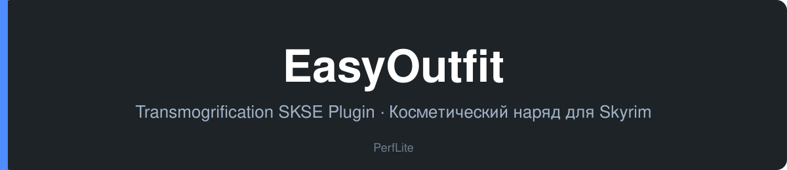

<div align="center">



<p>
  <a href="#english">🇬🇧 English</a> ·
  <a href="#русский">🇷🇺 Русский</a>
</p>

<p>
  
  
  
  
  
</p>

<p>
  <a href="https://github.com/PerfLite/EasyOutfit/releases/latest"><b>⬇️ Download / Скачать</b></a> ·
  <a href="https://github.com/PerfLite/EasyOutfit/releases">📦 All releases / Все релизы</a>
</p>

</div>

## ⬇️ Download / Скачать

| File / Файл | Description / Описание | Link / Ссылка |
|---|---|---|
| `EasyOutfit-v1.0.0.zip` | Main mod release (SE & AE) · Основной архив мода (SE и AE) | [Download](https://github.com/PerfLite/EasyOutfit/releases/latest/download/EasyOutfit-v1.0.0.zip) |

> Older versions and changelogs: [Releases](https://github.com/PerfLite/EasyOutfit/releases) ·
> Старые версии и список изменений: [Релизы](https://github.com/PerfLite/EasyOutfit/releases)

---

## English

A native C++ SKSE64 plugin powered by [CommonLibSSE-ng](https://github.com/CharmedBaryon/CommonLibSSE-ng) for transmogrification and visual cosmetic outfit management in Skyrim Special Edition and Anniversary Edition. Wear any gear for optimal stats while maintaining your preferred cosmetic appearance.

### Features

- **Seamless transmogrification**: replace the visual look of equipped armor and clothing without losing stats or enchantments.
- **In-game ImGui overlay**: intuitive interface integrated with [SKSE Menu Framework](https://www.nexusmods.com/skyrimspecialedition/mods/120352) (toggle with `F1` by default).
- **Multi-slot support & presets**: customize head, body, hands, feet, shield, amulets, rings, and switch between presets seamlessly.
- **Form transformation safety**: automatically suppresses cosmetic overrides during Werewolf (Beast Form) and Vampire Lord transformations.
- **JSON localization**: simple multi-language support (English, Russian) via `EasyOutfitStrings_<LANG>.json`.

### Install

#### Requirements

- [Skyrim Special Edition](https://store.steampowered.com/app/489830/) (`1.5.97`) / [Anniversary Edition](https://store.steampowered.com/app/489830/) (`1.6.x`, `1.6.1170+`)
- [SKSE64](https://skse.silverlock.org/)
- [Address Library for SKSE Plugins](https://www.nexusmods.com/skyrimspecialedition/mods/32444)
- [SKSE Menu Framework](https://www.nexusmods.com/skyrimspecialedition/mods/120352)

#### Steps

Install `EasyOutfit-v1.0.0.zip` using your mod manager (**Mod Organizer 2** or **Vortex**), or unpack the archive directly into your Skyrim `Data` directory:

```
https://github.com/PerfLite/EasyOutfit
```

### Build

```bash
xmake f -m release -y
xmake -y
```

### License

MIT — see [LICENSE](LICENSE).

<p align="right"><a href="#english">↑ Back to top</a> · <a href="#русский">Русский ↓</a></p>

---

## Русский

Нативный SKSE64-плагин на C++ (на базе [CommonLibSSE-ng](https://github.com/CharmedBaryon/CommonLibSSE-ng)) для трансмогрификации (косметических нарядов) в Skyrim Special Edition и Anniversary Edition. Носите любые доспехи ради защиты и характеристик, сохраняя любимый внешний облик.

### Возможности

- **Бесшовный трансмог**: замена визуального вида надетой брони и одежды без потери статов и зачарований.
- **Внутриигровое меню ImGui**: удобное окно управления через [SKSE Menu Framework](https://www.nexusmods.com/skyrimspecialedition/mods/120352) (открытие по умолчанию по клавише `F1`).
- **Поддержка пресетов и всех слотов**: настройка шлема, кирасы, перчаток, сапог, щита, колец и амулетов с мгновенным переключением.
- **Совместимость с формами зверя и вампира**: автоматическое отключение визуального слоя при превращении в оборотня или Лорда-вампира.
- **JSON-локализация**: полная поддержка перевода интерфейса (Русский, English) через `EasyOutfitStrings_<ЯЗЫК>.json`.

### Установка

#### Требования

- [Skyrim Special Edition](https://store.steampowered.com/app/489830/) (`1.5.97`) / [Anniversary Edition](https://store.steampowered.com/app/489830/) (`1.6.x`, `1.6.1170+`)
- [SKSE64](https://skse.silverlock.org/)
- [Address Library for SKSE Plugins](https://www.nexusmods.com/skyrimspecialedition/mods/32444)
- [SKSE Menu Framework](https://www.nexusmods.com/skyrimspecialedition/mods/120352)

#### Шаги

Установите `EasyOutfit-v1.0.0.zip` через ваш мод-менеджер (**Mod Organizer 2** или **Vortex**) либо распакуйте архив мода напрямую в папку `Data` игры:

```
https://github.com/PerfLite/EasyOutfit
```

### Сборка

```bash
xmake f -m release -y
xmake -y
```

### Лицензия

MIT — см. [LICENSE](LICENSE).

<p align="right"><a href="#русский">↑ Наверх</a> · <a href="#english">English ↑</a></p>
